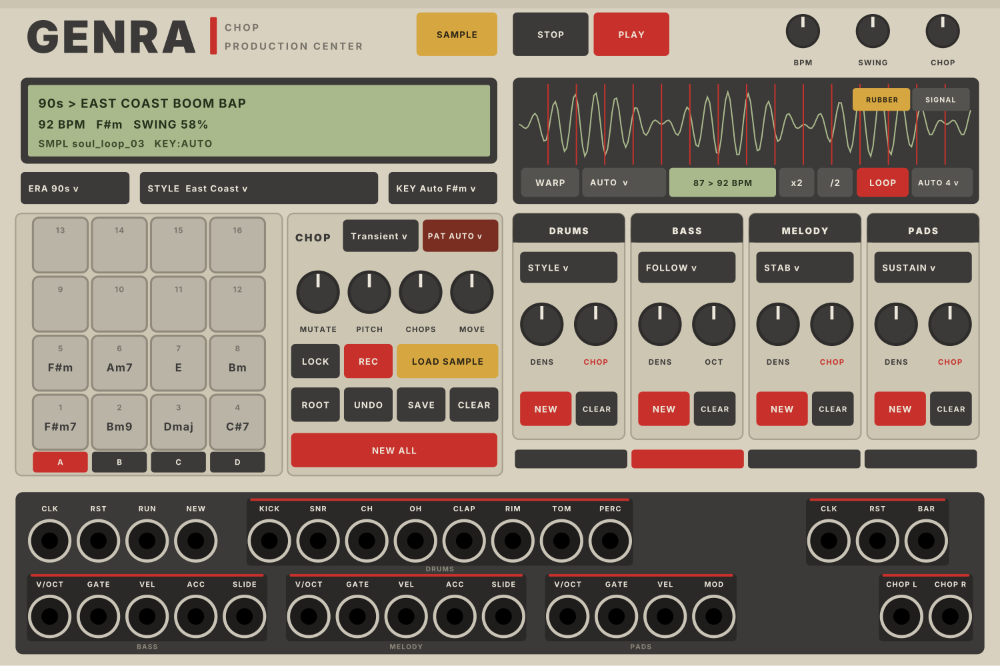
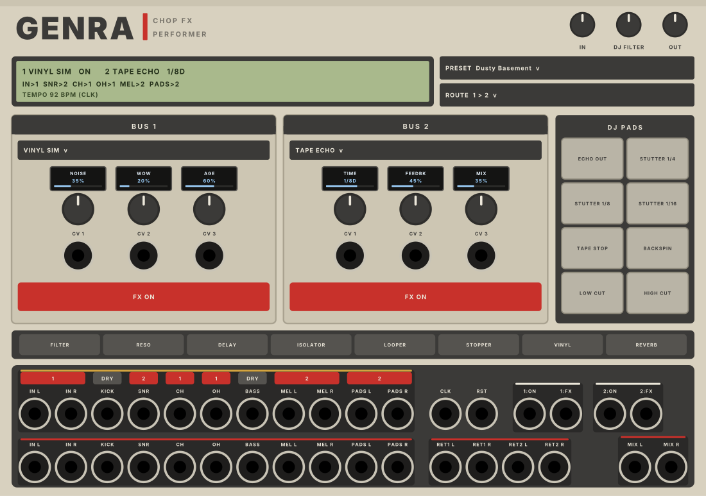

# GENRA CHOP

*English version. Deutsche Fassung: [README.de.md](README.de.md).*

A hip-hop beat generator styled after a classic production center (beige case, grey pads, Akai red, green LCD).
A plugin of its own (**GENRA CHOP**, slug `GenraChop`; up to 2.1.0 it was called GENRA HipHop, up to 2.4.0 it lived in
the GENRA Test repo) under the **Genra** brand. Four modules in one file: **GENRA CHOP** (38 HP),
**GENRA CHOP GRID** (the grid editor, 44 HP), from 2.2.0 **GENRA CHOP ABLAUF** (the song arranger, 26 HP) and from 2.3.0
**GENRA CHOP FX** (two effect buses for live playing, modelled on the SP-404, 36 HP).
Patches made with the old GENRA HipHop no longer load (new slug).



## Installing

Under **Actions**, open the latest successful run, download the artifact **genra-chop-windows** (Mac:
**genra-chop-mac-…**, only via Actions › Run workflow), put the `.vcvplugin` file into the plugins folder inside the
Rack user folder (Rack › Help › Open user folder) and restart Rack.

## Building it yourself

With the [VCV Rack SDK](https://vcvrack.com/manual/PluginDevelopmentTutorial) (Rack 2, on Windows in MSYS2 MINGW64):

```
make RACK_DIR=/path/to/Rack-SDK SLUG=GenraChop dist
```

The finished plugin is then in `dist/`. Nothing needs to be downloaded; the libraries for WARP are in `dep/`.
The engine tests run without Rack (see `.github/workflows/build.yml`).

## License

GPL-3.0 (`LICENSE`). Third-party code: Rubber Band Library (GPL-2.0-or-later) and Signalsmith Stretch / Linear (MIT);
origin and license texts in `licenses/`.

## Operation

**Header:** STOP and PLAY (larger from 2.3.0): STOP halts and jumps to bar 1 (pressing STOP twice also cuts off chops
and the break), PLAY starts at bar 1 (when nothing is patched into the RUN input). **BPM**, **SWING** (50 % straight to
75 %), **CHOP** (volume of the chops) and **BREAK** (volume of the break).

**Display:** era and style, tempo, key (a `*` means: set by hand), swing, bar; below that the sample (name, number of
chops, whether the key comes from the sample) or the progress of the analysis.

**ERA / STYLE / KEY:** click = list, mouse wheel = scroll. 29 styles by decade:
- **80s:** Electro Rap, Old School Boom Bap, Golden Age, Miami Bass, New Jack Swing
- **90s:** East Coast Boom Bap, Jazz Rap, Dark NY, G-Funk, West Coast Funk, Memphis, Dirty South
- **2000s:** Soul Chop, Dilla Wonky, Neptunes Timbaland, Crunk, Abstract, Snap
- **2010s:** Trap, Chicago Drill, UK Drill, Cloud Rap, Lo-Fi Hip-Hop, Ratchet, Grimy Revival
- **2020s:** Drumless, Rage, Plugg Pluggnb, Drift Phonk

A new style sets BPM and swing to its own values and re-rolls everything (UNDO takes it back). **KEY Auto** takes the
key from the sample; setting a key by hand re-rolls chords, bass, melody and pads.

**Pads (1–64):** 16 pads on the panel (from 2.4.0 laid out like on the MPC: 1–4 in the bottom row, 13–16 at the top),
below them **Banks A–D** (click selects; a bank without chops is shown faded). Each pad is one chop of the sample,
labelled with the detected chord (red = set by hand, HIT = no pitch; long chord names get smaller so they fit on the
pad). **Click** plays the pad. **Right-click:** Lock (stays put on NEW and MUTATE), Reverse, Pitch (−12 to +12) and
Chord (as detected, none, or by hand). At the bottom of the pad: L = Lock, R = Reverse, pitch.
Playable via MIDI (right-click › MIDI input; C1 = pad 1 up to pad 64, with velocity; the banks don't change anything
on the controller).

**CHOP:**
- **MODE:** Transient (cut at the strongest hits) or Equal (equal-length slices). Changing it re-slices.
- **CHOPS** (from 2.3.0, replaces DUST): how many chops, 4 to 64 (default 16). When the knob stops moving for a moment,
  the sample is re-sliced (like a new MODE: the chop pattern is re-rolled). If Transient finds fewer hits, the longest
  slices are halved; whatever is still missing stays empty (the display shows the count).
- **MUTATE:** how much of the chop track changes every four bars (0 = fixed).
- **PITCH:** all chops together, in semitones. (DUST is gone: vinyl, bits and dust live in GENRA CHOP FX.)
- **MOVE:** shifts the start of the chop you last tapped (mouse or MIDI) by ±250 ms and snaps to the nearest zero
  crossing. The chop before it ends where the moved one begins. In the waveform window the chop gets a yellow frame;
  the knob always shows the value of the tapped pad. UNDO takes back one turn. A new sample or a new MODE resets all
  shifts to 0. Hold Ctrl for finer steps.
- **LOAD SAMPLE** (yellow, to the right of the waveform window): load a WAV (Windows dialog, opens in the root folder:
  right-click › Sample root folder). Or drag the WAV file onto the module. The analysis runs in the background: chops,
  a chord per chop, key. Without a sample the display shows the last step (read, analysed, handed over, in use) or the
  error; the same is written to Rack's `log.txt`.
- **Cut by hand in the waveform window** (from 2.6.0): **drag a chop line** to move that cut (it snaps to the quietest
  point nearby, so it does not click; while dragging a yellow line shows "CHOP n"); **double-click on a line** = that
  chop goes (it merges into the one before); **double-click elsewhere** = a new chop there (up to 64). Chords and key
  are found anew, the pattern keeps playing (its pad numbers follow when a chop goes or comes). **UNDO** takes an edit
  back. With WARP the original is cut along, so warping again keeps the edit. Turning CHOPS cuts the sample fresh
  (the edits go). Without a sample a click in the window loads one; with a sample a click no longer loads (use LOAD
  SAMPLE).
- **Follow GENRA** (from 2.6.0, with GENRA / GENRA Instruments 2.39.0 or newer): the GENRA instruments (DRUM-X, SCHLAG,
  GRUND, FUNKE, SCHMELZ, MONO …) can follow GENRA CHOP without cables: right-click on the instrument › Follow GENRA ›
  the track, and under "Which GENRA" **GENRA CHOP #n** (automatic takes a GENRA first, a GENRA CHOP when there is
  none). They get drums, bass, melody, pads, clock and reset as from GENRA.
- **SAMPLE** (from 2.4.0, bottom left of the waveform window, lined up with STOP / PLAY below): plays the whole sample
  (as it sounds after WARP), a yellow line runs along in the waveform window; press again = stop.
- **WARP** (from 2.4.0, the strip below the waveform window): fits the sample to the tempo of the beat (only the
  sample, not the break). **WARP** switches it on / off. **Mode:** AUTO (chooses by itself: many tonal chops = TONE,
  otherwise BEATS), **BEATS** (each chop stays unchanged and just moves to its new position: punchy, no artefacts;
  like Ableton's "Beats"), **TONE** (real time-stretching, pitch is kept). The display shows "87 > 92 BPM" (detected
  tempo > tempo of the beat); **x2** and **/2** correct the detected tempo if it was found at half or double speed.
  Top right in the waveform window, **RUBBER | SIGNAL**: which stretcher TONE uses (Rubber Band R3: best quality, about
  1 s of computation for a 6 s sample; Signalsmith Stretch: faster). If BPM changes, the sample is re-warped after a
  short pause (in the background; the chops and the pattern stay).
- **LOOP** (from 2.5.0, right in the WARP strip): the whole sample plays as a loop in time instead of the chop
  pattern. It starts with PLAY on bar 1 and starts again every LOOP length; its speed always fits that length
  exactly, so it never drifts away from the beat. Switching LOOP on also switches WARP on. The field next to it: the
  length, **AUTO** (from the sample's length at the tempo playing, 1, 2, 4, 8 or 16 bars) or set by hand. The chop
  pattern rests while LOOP is on, the pads can still be played on top. LOOP is stored with the pattern: GENRA CHOP
  ABLAUF keeps it per pad, so one part can loop and the next one chop. The waveform window shows "LOOP 4 BARS" and a
  line where the loop is.
- **REC:** what you play on the pads (mouse or MIDI) lands on the next step of the chop track (one UNDO step per
  recording).
- **CLEAR:** short press = the whole chop pattern empty (sample, chops and the other tracks stay). **Hold CLEAR and
  tap pads** = delete only the hits of those pads. Both can be undone with UNDO, even while the beat is running.
- **LOCK:** locks the chords of the four bars (NEW re-rolls everything else).
- **ROOT:** hold = root note of the key for comparison (through the chop output).
- **UNDO:** up to eight steps back (before every NEW, CLEAR, recording, MOVE turn, style and sample change).
- **SAVE:** saves the chops as WAV files into a folder (no file dialog; default
  `Documents/Chops from Genra/<date>_<sample>/`). Right-click: with the pads' pitch and reverse, or raw (default).
- **NEW ALL:** everything new (also via the NEW input). From 2.4.0 this also re-slices the sample: CHOPS back to 16,
  all MOVE shifts 0, slicing in the selected MODE. The chop track no longer has its own NEW: bass and melody follow
  the chops anyway.

**Tracks:** each has a field for the playing style, **DENS** (density), **NEW** and (from 2.4.0) **CLEAR**: empties the
track, the chords stay; NEW or NEW ALL fills it again.
- **DRUMS:** KIT (triggers only), BREAK (break only), BOTH. **CHOP** = MIDI chop (repeat, stutter, skip, reverse
  beats). Load a break via right-click › Load break: the hits are sorted by brightness onto kick, snare, hats … and are
  played by the drum hits (output BRK L/R). From 2.4.0, turning **DENS** to the right adds style-typical extras on
  voices the style leaves empty: rim ghosts, tambourine/shaker on PERC (syncopated for trap), open hats for funk and
  trap, clap on the snare, a tom fill at the end of bar 4. From 2.5.0 the **hi-hats** come early (from about 30–40 %:
  boom bap gets quiet ghost hats between the eighths, trap its 16ths and rolls sooner, an open hat into bar 1 more
  often); the **clap** only comes now and then (on bar 2 and / or 4, from about 80 %; styles with their own clap
  keep it); the **tambourine** is rarer and quieter (from about 75 %). In BREAK and BOTH, clap, rim and PERC no longer
  get snare-like pieces of the break: they take brighter, hat-like pieces, or stay silent.
- **BASS:** FOLLOW (style, follows the chords of the chops), ROOT+5, WALK, 808. **OCT** instead of CHOP (no MIDI chop).
  DENS fully left: root notes only (at least two per bar); to the right, pickups before the snare, octave jumps, runs
  into the next chord and 16th ghosts are added. Root notes ring until just before the next one (East Coast stays
  short and punchy).
- **MELODY:** STAB, LEAD, ARP, RIFF; **CHOP** = MIDI chop. Where a chop comes in, the melody steps back.
- **PADS:** SUSTAIN, STAB, SWELL (MOD output rises); **CHOP** = MIDI chop.

**Jacks:** CLK (16ths; 24 / 48 PPQN in the menu), RST, RUN, NEW. Drums: 8 triggers (voltage = velocity), from 2.4.0
in the order **Kick, Snare, CH, OH, Clap, Rim, Tom, Perc** (only in GENRA CHOP and GRID; ABLAUF unchanged); Break L/R;
CLK, RST, BAR (trigger on every downbeat). Bass and melody: V/OCT, GATE, VEL, ACC, SLIDE.
Pads: V/OCT and GATE poly 4, VEL, MOD. Chop L/R.

**Right-click:** load sample and break, clear break, chop folder, **Export MIDI** (four bars, five tracks: drums on
channel 10 with GM notes, bass, melody, pads, chop with pad 1 = C1, pitch as pitch bend ±12, reverse as CC 20;
no file dialog, into the MIDI folder shared by all GENRA modules), MIDI input, clock resolution, MIDI control.

## MIDI learn (from 2.2.0)

Every knob, button and field of GENRA CHOP and GENRA CHOP ABLAUF can be controlled from a MIDI controller
(e.g. Akai MPD218: pads, endless encoders).
- **Choose a controller:** right-click the module › *MIDI control* › Controller 1–3 (up to three at once).
- **Learn:** right-click a knob / button / field › *MIDI learn*, then turn or press something on the controller.
  While it is waiting, a yellow ring blinks (the display shows what it is waiting for).
- **Knobs:** absolute CC (0–127 across the range) or **endless encoder** (1 / 127 or 63 / 65). Auto detects an
  encoder by itself (the same value twice in a row); can be changed by hand in the *MIDI mode* menu. On the MPD218,
  set the knobs to relative (Inc/Dec) in the MPD218 Editor. MOVE is especially fine-grained with an encoder.
- **Buttons:** note on/off or CC ≥ 64 = press (so holding CLEAR + pads also works from the controller).
- **Fields (ERA, STYLE, KEY, modes, FORM):** CC across the list, encoder one step per detent, a note steps forward.
- **Stored per controller** (device name) **on this computer**, valid in all patches
  (`<Rack user folder>/Genra/chop-midi-map.json`); the chosen controllers too. Each target has exactly one control.
- **Overview:** *MIDI control › Mappings* (change mode, delete), *Export mappings* (into the MIDI folder, subfolder
  "MIDI maps"), *Import mappings…* (e.g. for a laptop or Mac).
- A note learned as a button no longer plays a chop pad (the pad MIDI input skips it).

## GENRA CHOP GRID: the grid editor (44 HP)

Edits the pattern of GENRA CHOP note by note. **Connection:** place it directly to the left or right of GENRA CHOP
(LINK lights up green) or right-click › *Connect to…*.

- **TRACK:** DRUMS (grid, 8 voices), BASS, MEL, PADS (piano roll), CHOP (grid, as many rows as the sample has chops,
  at least 16, with chord). The black keys on the left of the piano roll are black.
- **VIEW:** BAR (first visible bar), ZOOM (1/2/4 bars), PITCH (note range of the piano roll, remembered per track),
  AUTO (view follows playback). Top right: **ALL / SCALE / USED** (which note rows) and **ONE / GHOST / ALL 5**
  (one track; the other pitched tracks faded behind it; all five as strips, click selects, double-click opens).
- **NOTES:** VEL, LEN, CHANCE for new notes. **SNAP** switches OFF / SCALE / CHORD (with Shift: snap the whole
  track). **FOLLOW:** edited bass, melody and pad notes move along with new chords.
- **EDIT:** UNDO, REDO (64 steps), COPY / PASTE BAR (first visible bar), CLEAR TRACK, GEN TRACK (track generative
  again), **REC** (notes from the MIDI input at the play position; right-click › MIDI input; from 2.4.0: if nothing
  is selected there, the GRID uses GENRA CHOP's MIDI input).
- **Grid (drums, chop):** click sets / deletes, drag paints / erases, mouse wheel = velocity. Clicking a row name
  selects the voice for the VEL/CHANCE lane.
- **Piano roll:** click sets a note (drag right = length), drag a note = move, right edge = length, double-click
  deletes. Scale notes are brighter, chord notes greenish, the chords are shown above.
- **Right-click on notes:** roll 2–4× (drums, chop), accent, slide, pitch and reverse (chop), velocity, chance,
  "only every 2nd pass", delete; **Track tools** (rotate, reverse, double / half speed, transpose,
  velocity random / equal).
- **Keys (mouse over the grid):** Shift + drag = box select, Ctrl + click = select / deselect, Ctrl+A / C / V / D,
  Del, arrows (Shift: octave / bar), Alt + ←/→ = nudge 1/24 step, Ctrl+Z / Ctrl+Y.
- **Own length and own swing:** drag the yellow end marker (per drum voice or per track, double-click = back to the
  loop); drag the swing fields on the right up/down (double-click = back to global).
- **Edited:** the first change to a track turns whatever DENS is currently showing into fixed notes. DENS then no
  longer affects that track and NEW ALL leaves it alone; GEN TRACK makes it generative again.
- **MIDI (right-click):** export (all tracks or only the selected one, no file dialog), import a MIDI file
  (tracks by name or channel: 10 drums, 1 bass, 2 melody, 3 pads, 4 chop).

## GENRA CHOP ABLAUF: store patterns, build songs (26 HP, from 2.2.0)

The song arranger for GENRA CHOP, based on GENRA's ABLAUF. **Connection:** place it next to GENRA CHOP (ABLAUF | GRID |
GENRA CHOP works too), or there is only one GENRA CHOP in the patch, or right-click › *Connect to…* (LINK lights up
green). One sample per song: the pads store patterns, not samples.

- **PATTERNS:** 64 slots, banks **A–D** with 4 × 4 pads each. **Tapping an empty pad** stores what GENRA CHOP is
  currently playing (**GENRA 1**, **GENRA 2** … – each starts a family, with a bar at the top in its colour). Tapping
  a used pad selects it; in **PATT** mode it plays at the end of the current pattern (dashed = waiting, white =
  playing; immediately if GENRA CHOP is stopped). Right-click: name (type, Enter), part, insert into the song,
  *Overwrite with GENRA CHOP*, export as MIDI, delete. The line below the pads shows the selected pad and messages.
- **VARIATION** (INTRO, VERSE, HOOK, BRIDGE, BREAK, OUTRO): makes a variant of the family's original (from the selected
  pad; if the running pattern isn't stored yet, it is stored first) on the next free pad (**HOOK 1**, **HOOK 2** …)
  and starts playing it. As in the old GENRA ABLAUF: **every press makes a new pattern** on the next free pad. Bass,
  melody and pads get new notes; drums and the chop track stay those of the original (only shaped by the part), the
  chords always stay.
  (The VARIATION RENEWS buttons are gone from 2.3.0.)
  - **INTRO:** thinner drums (no toms/percussion, hats on 8ths, kick on 1 and 3), pads up front, thin melody;
    across the song row: first half without bass, melody and snare, first quarter also without kick.
  - **VERSE:** room for the vocal: chops quieter and slightly fewer, melody leaves gaps (DENS still applies).
  - **HOOK:** chop track fuller (empty beats repeat the previous chop), clap on the snare, fuller melody,
    louder pads.
  - **BRIDGE:** halftime (kick on the one and late in the bar, snare on three), every second chop reversed,
    long bass root notes.
  - **BREAK:** drums out except quiet hats (which are also missing in the first half of the row), the sample carries
    it; the bass changes with every press: long root notes, thinned out or gone; snare pickup at the end of the row.
  - **OUTRO:** thins out across the row (melody, then hats, then bass and snare), in the last bar only kick, chop,
    pads.
- **CLEAR | CLEAR ALL** (below the pads, from 2.3.0): **CLEAR**, then tap a pad = that pad emptied (CLEAR lights red
  until a pad is tapped; pressing CLEAR again cancels). Press **CLEAR ALL** twice (blinks for 2.5 s after the first
  press) = all 64 pads emptied; the song list stays (its rows play nothing until the pads are filled again). **UNDO**
  brings both back. Both can be controlled via MIDI learn.
- **SONG:** the song list (row: pattern, bars, F = transition at the end). Click selects, mouse wheel scrolls,
  right-click: bars, transition on/off, pattern = selected pad, up/down, duplicate, delete. At the bottom: bars and
  play time.
  From 2.5.0: a pad stores whether GENRA CHOP plays **LOOP** (a red **L** top right on the pad); right-click on a pad ›
  **LOOP** switches it for that pad. So a song can loop the sample in the intro and chop it in the verse.
  From 2.4.0: **drag a pad into the list** to insert it there (a red line shows the spot), **drag a row** to move it.
  Long songs get a **scroll bar** on the right (click or drag); when dragging to the top or bottom edge the list
  scrolls by itself.
  **INS** inserts the selected pad after the selected row, **DEL** deletes the row, **UNDO** takes steps back (pads
  and list), **MIDI** writes the whole song as MIDI (no file dialog, one marker per row).
- **PATT | SONG:** the mode. **PLAY** in SONG plays from the selected row (if GENRA CHOP is already running: from the
  next bar), in PATT the selected pad. **STOP** halts (STOP on GENRA CHOP also stops the song), STOP twice = back to
  the start of the song. Right-click › *Loop the song*.
- **MAKE SONG** builds a song from the family of the selected pad in the **FORM** next to it (AUTO = the style's
  form): existing variants are used, missing ones are built; the HOOK returns as the same one. Before every change of
  part MAKE SONG sets a transition. UNDO takes everything back in one step.

| Form | Styles with AUTO | Structure (bars) |
|---|---|---|
| BOOM BAP | Golden Age, East Coast, Jazz Rap, Dark NY, Soul Chop, Grimy Revival | INTRO 4 · VERSE 16 · HOOK 8 · VERSE 16 · HOOK 8 · BRIDGE 8 · HOOK 8 · OUTRO 4 |
| OLD SCHOOL | Electro Rap, Old School, Miami Bass | INTRO 8 · VERSE 16 · HOOK 4 · VERSE 16 · HOOK 4 · BREAK 8 · VERSE 16 · HOOK 4 · OUTRO 8 |
| WEST COAST | New Jack, G-Funk, West Coast Funk, Neptunes, Ratchet | INTRO 8 · VERSE 16 · HOOK 8 · VERSE 16 · HOOK 8 · BRIDGE 8 · HOOK 8 · OUTRO 8 |
| SOUTH · CRUNK | Memphis, Dirty South, Crunk, Snap | INTRO 8 · HOOK 8 · VERSE 16 · HOOK 8 · VERSE 16 · HOOK 8 · BREAK 4 · HOOK 8 · OUTRO 4 |
| TRAP · DRILL | Trap, Chicago Drill, UK Drill, Cloud Rap | INTRO 8 · HOOK 8 · VERSE 16 · HOOK 8 · VERSE 16 · BRIDGE 8 · HOOK 8 · OUTRO 4 |
| SHORT (2020s) | Rage, Plugg, Drift Phonk | INTRO 4 · HOOK 8 · VERSE 16 · HOOK 8 · OUTRO 4 |
| BEAT TAPE | Dilla Wonky, Abstract, Lo-Fi, Drumless | INTRO 4 · VERSE 8 · HOOK 8 · VERSE 8 · BREAK 4 · HOOK 8 · OUTRO 4 |

- **Transitions** (last bar of a row with F; plus a light fill every 8 bars in long VERSE and HOOK rows):
  **trap-like styles** (808, hat rolls) roll the hats into the next part; before the HOOK, 808 and kick stop on the
  last beat and the chop runs backwards into it as a riser. **Boom bap and the rest:** snare fill, tom fill or stop
  (only the sample on the last beat; before a BREAK always the stop).
- GENRA CHOP shows the part that is currently playing in its display.
- **Jacks:** ROW CV (0–10 V across the song list, from the next bar), RESET (to the start of the song), RUN (trigger:
  play/stop), NEXT / PREV (next / previous row or pad), PAD CV (0–10 V across the 64 pads, at the end of the pattern);
  END (end of song), BAR (every bar), ROW (every new row).
- **How it plays:** GENRA CHOP keeps its own clock. On the last 16th of every bar, ABLAUF decides in the audio thread
  what the next bar is and hands GENRA CHOP its pattern; a new row restarts GENRA CHOP's loop at step 1. So a hanging
  file dialog can't make a row come in late.

## GENRA CHOP FX: two effect buses for live playing (36 HP, from 2.3.0; from 2.4.0 with individual inputs and outputs)

Modelled on the SP-404, in GENRA CHOP's retro look. From 2.4.0 the tracks come in individually and go out
individually again (intended for WING-LINK with the Behringer Wing: one fader per track, 16 mono channels), the
effects sit on their own returns. For now it is connected with cables only (GENRA CHOP's track outputs, its CLK output
to CLK).
**2.3.0 patches with GENRA CHOP FX no longer load the cables correctly** (the panel is new, 22 → 36 HP).



- **Inputs (8 sources):** IN L/R, KICK, SNR, CH, OH, BASS, MEL L/R, PADS L/R (for stereo: L only = mono to both).
  Above each source a **selector DRY / 1 / 2 / 1+2**: where it goes (click = next, mouse wheel, right-click = list).
  No level knobs: the mixing desk does the levels.
- **Outputs:** below each input its output. Plus **RET 1 L/R**, **RET 2 L/R** and **MIX L/R** (everything together).
  - An effect that **adds something** (echoes, reverb) leaves the source dry on its own output and puts only what it
    adds onto the return.
  - An effect that **changes the sound** (filter, vinyl, looper, stops …) crossfades the source from its own output
    over to the return on FX ON, and back again on FX OFF.
- **Header:** **IN** and **OUT** (level, up to +6 dB; above about 8 V the output soft-clips), **PRESET** (whole
  setups; the buses stay off until you play them), **ROUTE**: 1 > 2 (what bus 1 does goes on through bus 2; "1+2" then
  means: through both), 2 > 1, 1 + 2 (side by side).
- **BUS 1 / BUS 2:** the **effect field** (click = list in six groups, mouse wheel = scroll), **CTRL 1–3**, each with
  a small **OLED display** above it (as on the MPC X: what the knob does and its value), their CV jacks below.
  **FX ON:** tap = on / off, hold = only while held. A bus is selected by clicking its title (red line), its effect
  field, FX ON or one of its knobs.
- **Quick keys (8):** put their effect on the selected bus and switch it on (tap = stays on, hold = only while held).
  Right-click: which effect, back to the factory assignment. Factory: FILTER+DRIVE, RESONATOR, DELAY, ISOLATOR,
  LOOPER, STOPPER, VINYL, REVERB.
- **DJ pads (8):** act on **all outputs** while you hold them. Factory: ECHO OUT, STUTTER 1/4, 1/8, 1/16, TAPE STOP,
  BACKSPIN, LOW CUT, HIGH CUT. **Right-click:** any effect from the list, *Copy settings from BUS 1 / 2* (the bus's
  effect and CTRL positions), back to the factory pad.
- **DJ FILTER:** one knob for all outputs: left low-pass, right high-pass, centre = off.
- **Jacks at the bottom in two rows:** **CLK** (16ths; without a clock the tempo from the menu, default 90 BPM),
  **RST**, per bus **CV 1–3** (±5 V = ± half the knob travel), **ON** (gate) and **FX** (0–10 V across the effect
  list).
- **MIDI learn:** as on GENRA CHOP (right-click on knobs, buttons, fields, DJ pads; controller in the module menu).

**The effects** (CTRL 1 · CTRL 2 · CTRL 3):

| Group | Effect | CTRL 1 · 2 · 3 |
|---|---|---|
| TEXTURE | VINYL SIM | NOISE (crackle, hiss) · WOW · AGE (thinner, duller) |
| | CASSETTE SIM | SAT · WOBBLE (wow and flutter) · TONE (duller, noise) |
| | LO-FI | BITS (16 down to 3) · RATE (sample rate down to 1/40) · TONE |
| | WOW & FLUTTER | DEPTH · RATE · MIX |
| | RADIO | BAND (300–3000 Hz) · WIDTH · DIRT (distortion, noise) |
| | DUST | CRACKLE · HISS · POPS (added to the signal) |
| | WARP | DEPTH · SPEED · MIX (warped record: one sag per revolution) |
| FILTER | FILTER+DRIVE | CUTOFF · RESO · DRIVE (low-pass) |
| | SUPER FILTER | CUTOFF · RESO · SWEEP (over one bar, in tempo) |
| | ISOLATOR | LOW · MID · HIGH (fully left = gone, centre = 0 dB, right up to +6 dB) |
| | RESONATOR | TUNE (C2–C4, root, fifth, octave) · RING · MIX |
| | TALK FILTER | VOWEL (A–E–I–O–U) · RESO · MIX |
| | AUTO WAH | SENS · RANGE · RESO |
| | LOW CUT · HIGH CUT (from 2.4.0) | TIME (sweep from FX ON) · RANGE · RESO |
| DRIVE | SATURATOR | DRIVE · TONE · MIX |
| | FUZZ | FUZZ · TONE · LEVEL |
| | WAVEFOLDER | FOLD · BIAS · MIX |
| | COMPRESSOR | AMOUNT (threshold, ratio) · SPEED (right = pumps) · MIX (parallel) |
| | GATER | RATE (1/4–1/32) · DEPTH · SMOOTH |
| SPACE | DELAY · TAPE ECHO · PING PONG · REVERSE DELAY | TIME (1/32 to 1 bar, also triplet / dotted) · FEEDBACK · MIX |
| | REVERB | SIZE · TONE · MIX |
| MOD | CHORUS | RATE · DEPTH · MIX |
| | FLANGER · PHASER | RATE · DEPTH · FEEDBACK |
| | RING MOD | FREQ (20–2000 Hz) · WOBBLE · MIX |
| | TREMOLO / PAN | RATE · DEPTH · PAN (0 = tremolo, right = auto-pan) |
| | VIBRATO | RATE · DEPTH · MIX |
| PERFORM | LOOPER | LENGTH (1/32 to 1 bar, fully right FREEZE) · SPEED (×0.5 to ×2) · MIX |
| | SCATTER | AMOUNT · SLICE (1/16, 1/8, 1/4) · MIX: pieces of the last bar shuffled, some reversed |
| | STOPPER | PATTERN (8 rhythms) · DEPTH · SMOOTH: rhythmic stops |
| | TAPE STOP | TIME · CURVE · MIX: slows down to a standstill |
| | BACKSPIN | TIME · SPEED · MIX: record spun backwards |
| | TAPE START | TIME · CURVE · MIX: starts up from standstill, then live again |
| | DOWNER | TIME · DEPTH (down to −24 semitones) · MIX: slowly pulls down |
| | SUB OCTAVER | SUB · TONE · OCT (−1 or −2 octaves) |

- **LOOPER** as on the SP-404: from FX ON one pass runs live and is recorded at the same time, then it repeats;
  **FREEZE** holds a quarter of a second smoothly (two crossfaded heads). The stops and spins restart on every FX ON
  (also via a quick key).
- **Echoes and reverb ring out after FX OFF**; the other effects fade in and out smoothly in 8 ms; changing the effect
  crossfades in 5 ms.
- **CPU:** a bus that is off and silent sleeps (only the recording of the last few seconds for the looper and spins
  is computed). Only the selected effect is computed; filter coefficients only when a knob moves (checked every 16
  samples). The distortions use a cheaper smoothing (antiderivative anti-aliasing) instead of oversampling.
  In the test (48 kHz) a running effect costs less than 0.2 % of one CPU core (vinyl, reverb and saturator the most).
- **Without cables** (from 2.6.0, right-click): **Sound at IN from GENRA CHOP** (off, CHOP L/R, or CHOP + BREAK) and
  **Clock and reset from GENRA CHOP**; which GENRA CHOP (automatic: the only / first one). A cable in IN L/R, CLK or
  RST always wins. A yellow segment over the jack shows what comes without a cable.
- **Levels** (from 2.6.0): at their default settings the effects are about as loud as the dry signal (a level trim per
  effect, measured in `test/fx_test.cpp`); LOW CUT, TAPE STOP and BACKSPIN are quieter on purpose, echoes and reverb
  add on top. The presets "Spaced Out" and "Robot Talk" were tamed a little.

## Not in yet (to-do list)

- The PITCH knob shifts the chops, but not yet the detected chords used for bass and pads.

## Technical notes

- `src/hh/Core.*`: the generator (four bars of 16 steps, five tracks; DENS and MIDI chop are computed live from the
  base), `src/hh/Styles.cpp`: the 29 styles, `src/hh/Chop.*`: WAV read/write, slicing (spectral flux),
  12-tone fingerprint per chop, chords (template matching), key (Krumhansl profiles). Testable without Rack:
  `test/hh_test.cpp` (runs as part of the build).
- `src/hh/Song.*`: parts, song forms, progression across the row and transitions (also in the test).
- `src/GenraChopModule.hpp`: the module (with the exchange interface for GRID and ABLAUF), `src/GenraChop.cpp`:
  its panel, `src/ChopUI.hpp`: shared look, `src/ChopGrid.cpp`: the grid editor, `src/ChopAblauf.cpp`: the song
  arranger, `src/MidiLearn.hpp`: MIDI learn, `src/Export.*`: MIDI file (whole songs too) and folders.
- `tools/grid_panel.py` writes `res/ChopGrid.svg` and `src/ChopGridLayout.hpp`; `tools/ablauf_panel.py` writes
  `res/ChopAblauf.svg` and `src/ChopAblaufLayout.hpp`.
- `src/fx/FxEngine.*`: the 39 effects and the presets of GENRA CHOP FX (testable without Rack: `test/fx_test.cpp`, runs
  as part of the build: every effect on, off, ringing out, sleeping, finite and level-safe, changing effects while
  running, what it costs); `src/ChopFx.cpp`: module and panel; `tools/fx_panel.py` writes `res/ChopFx.svg` and
  `src/ChopFxLayout.hpp` (preview: `--preview docs/genra_chop_fx.png`).
- `src/warp/Stretch.*`: WARP with Rubber Band (R3) or Signalsmith Stretch, both unmodified in `dep/`; origin and
  licenses in `licenses/` (Rubber Band GPL-2.0-or-later, Signalsmith MIT). Tempo detection in `src/hh/Chop.*`
  (`findTempo`, in the test).
- `tools/chop_panel.py` writes `res/GenraChop.svg`, the knobs and `src/GenraChopLayout.hpp`; checks that no text
  overlaps. Preview: `python3 tools/chop_panel.py --preview docs/genra_chop.png`.
